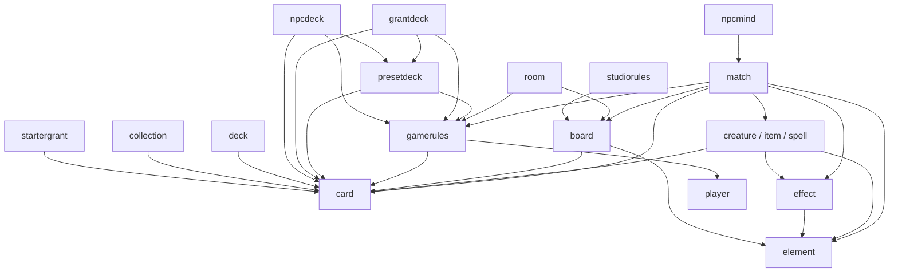
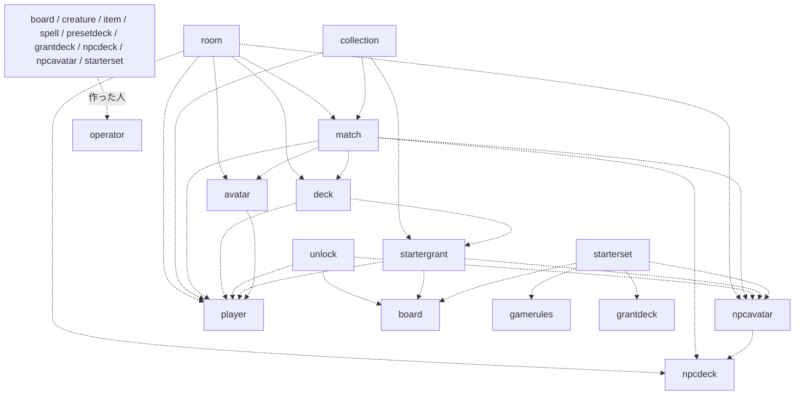

# domain のパッケージと集約の関係

core/internal/domain の全パッケージ（集約と語彙）の関係（core#189。2026-11-17 オーナー）。新しい集約・語彙の名前や置き場所を議論するときの土台にする。パッケージを足す・依存を変えたら、この図と表も直す（依存は `go list -f '{{.ImportPath}} {{join .Imports " "}}' ./internal/domain/...` で確かめられる）。

## 決まり

- domain の直下はフラットに保つ（階層にしない。階層にすると収拾がつかず、別の集約の下で名前が重なると import の別名が要るため）
- 上の段は下の段だけを読む。同じ段どうしは読まない
- 仲介は上ではなく下に置き、複数が使う語彙だけを下の段（`element` 等）に降ろす。カードとボードは `match` から見て並ぶもので、互いを読まない
- 線は 2 種類ある。**語彙を使う**（値オブジェクト・決まり・効果の定義等を使う）と、**ID で指すだけ**（ほかの集約を同じ境界の内部 ID で指す。作った人の `operator.ID`、持ち主の `player.ID` 等）。ID で指すだけの線も import になるので段を決めるが、意味の結び付きは弱い
- 集約・語彙・ドメインサービス: 集約はイベントを持ち、どちらかのサービス（studio・game）のコマンドが変える。語彙は集約を持たず、値と決まりだけ。ドメインサービスは状態とイベントを持たず、ほかの集約の状態を読んで判断するだけ（ロジックは `service.go`。2026-11-17 オーナー。core#190）

## パッケージ

| 段 | パッケージ | 種類 | サービス | 役目 |
|---|---|---|---|---|
| 0 | `card` | 語彙 | ― | カードとは何か（識別と状態 `Ref`・`Status`、共通の性能 `Cost`・`Rarity`、カードの分類（種類と、その下のアイテムの分類）、デッキの枚数の値） |
| 0 | `element` | 語彙 | ― | カードとボードが共に使う属性（クリーチャーの属性 `Creature` と土地の属性 `Land`。別の概念なので型も別。集合の決まりは持たない） |
| 0 | `operator` | 集約 | studio | オペレーター |
| 0 | `player` | 集約 | game | プレイヤー（持てる数の値 `MaxDecks`・`MaxAvatars` も持つ） |
| 1 | `effect` | 語彙 | ― | 効果の定義（効果の種類・値・制約、スペルの効果）。誰が持つかによらない |
| 1 | `board` | 集約 | studio | ボード（レイアウト・既定のルール） |
| 1 | `gamerules` | 集約 | studio（game は写しを読む） | ゲーム全体のルール |
| 1 | `avatar` | 集約 | game | プレイヤーのアバター |
| 2 | `creature`・`item`・`spell` | 集約 | studio | カードの種類ごとの集約と、その種類だけの性能・持てる効果の表 |
| 2 | `presetdeck` | 集約 | studio | プリセットデッキ |
| 2 | `studiorules` | 集約 | studio | studio でマスタを作るときの決まり |
| 3 | `grantdeck` | 集約 | studio | 配布デッキ |
| 3 | `npcdeck` | 集約 | studio | NPC のデッキ |
| 4 | `npcavatar` | 集約 | studio | NPC のアバター（使う NPC のデッキを持つ） |
| 5 | `starterset` | 集約 | studio | スターターセット（配るデッキ・解放するボードと NPC） |
| 5 | `startergrant` | 集約 | game | スターターの配布の流れ（プロセスマネージャー） |
| 5 | `unlock` | 集約 | game | プレイヤーの解放（ボード・NPC） |
| 6 | `deck` | 集約 | game | プレイヤーのデッキ |
| 7 | `match` | 集約 | game | 対戦。効果の当て方（戦闘・通行料・侵略と移動）、選べる行動の種類（`Action`） |
| 8 | `room` | 集約 | game | 部屋 |
| 8 | `collection` | 集約 | game | プレイヤーの所持品（カード） |
| 8 | `npcmind` | ドメインサービス | game | NPC が選ぶやり方（`Choose`。採点基準 `Criterion` で候補に点を付けて選ぶ。core#190）と、行動の種類ごとの重み（`Weights`）・採点基準ごとの重み（`CriterionWeights`） |

## 語彙を使う線

- `creature / item / spell` → `element` は `creature` だけ（クリーチャー自身の属性と配置制限）。`item`・`spell` は `element` を読まない
- `match` は語彙の大半を読む（カードの性能・効果・ボードの形・全体のルールを、対戦を始めるときに写して使うため）
- `grantdeck`・`npcdeck` → `presetdeck` は、写した元の記録（`Source`。ID と revision と名前の型）
- `gamerules` → `card`・`player` は、ルールの値の型（デッキの枚数・持てる数）が持ち主の側にあるため（`deck` に置かないのは、deck の下の層が gamerules を読み循環するため）

## ID で指すだけの線

- 作った人（`registered_by` 等）として、studio のマスタのほとんどが `operator.ID` を指す（図では 1 本にまとめた）
- `deck` → `startergrant`・`collection` → `startergrant` は、配布の流れが作り終えたことを知る目印（最初の中身をどこから得たか）。このため `match` → `deck` → `startergrant` → `npcavatar` → `npcdeck` → `presetdeck` と、ID の線を通って依存の鎖が深くなっている
- `collection` → `match` は、戦利品の出どころ（`MatchRewardSource`）
- `room` → `match` は、部屋で始めた対戦。対戦は部屋を指さない（循環するため。対戦から部屋は read model で引く）

## 気をつけること

- `effect` は `board` を読まない（施設が効果を持つときに足す `board` → `effect` の線と循環するため）。効果の定義が指すボードの語彙は `element` の段に降ろす。属性ではない語彙（マスの種類等）を指すようになったら、その段の名前と範囲を相談する
- 集合の決まりは持ち主の側に置く: クリーチャー自身の属性（無以外は 1〜4 つを組み合わせて持て、無は無だけ）・配置制限（火・地・水・風の 0〜4 個）・アイテム制限（分類の 0〜3 個）は `creature`、制約の属性（1 つ以上。無とほかを一緒に選べる）は `effect`
- `card` は「カードとは何か」を説明するときに種類によらず出てくる語彙で、「ほかから参照されるか」で置き場所を決めない
- 施設を作るときは `board` → `effect` の線を足す

## 予定（決まったが、まだ入っていない）

core#188（思考パターンのマスタ。2026-11-17 オーナー）で次のように変える。

- 思考パターン（データ）の集約 `npcmindset`（`npc_mindset`。studio のサービス）を足し、重み（`Weights`・`CriterionWeights`）をここに置く。`npcavatar` が割り当てる
- `npcmind` を `npcchoice`（NPC の選択。やり方）に変える
- 行動の種類 `Action` を `match` から下の段の語彙のパッケージに降ろし、依存を 語彙 ← `npcmindset` ← `match` ← `npcchoice` の向きにする（データの集約がやり方を読む逆向きにしないため）
