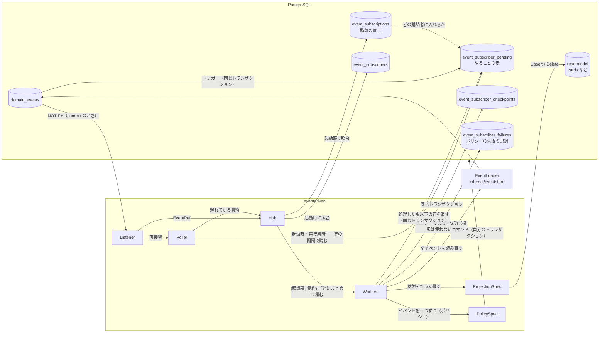
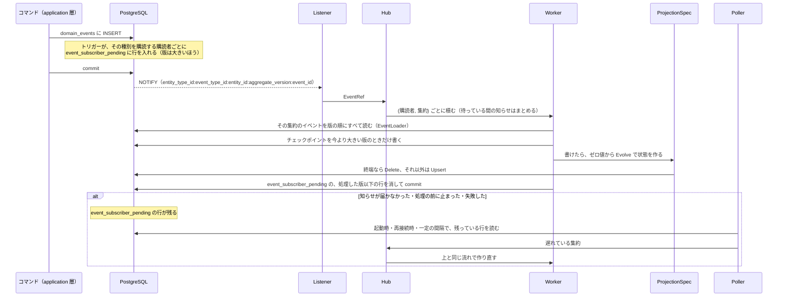
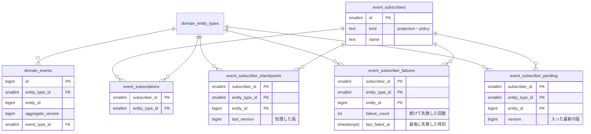
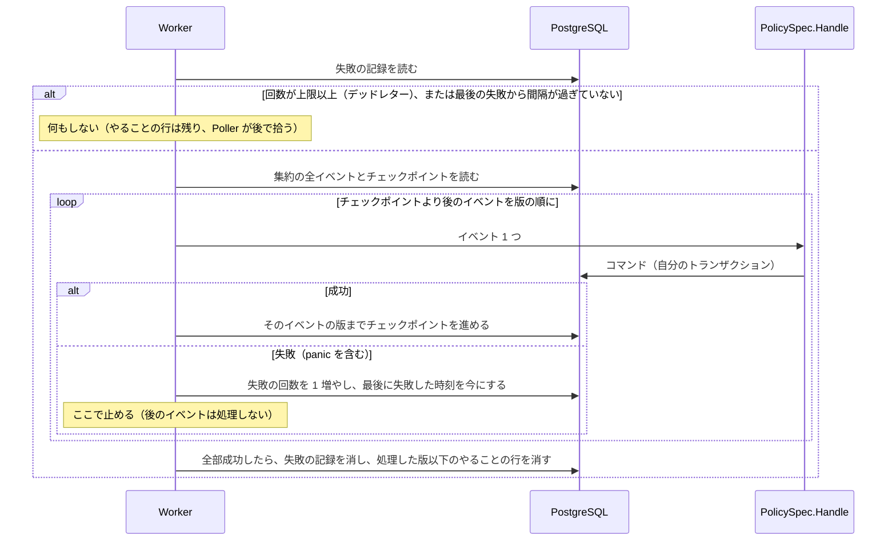

# internal/eventdriven

domain_events に保存されたイベントを受け取り、購読者に渡す仕組み。購読者は 2 種類ある。投影（Projection）は read model を作る。ポリシー（Policy）はイベントを受けてコマンドを動かす。PostgreSQL の LISTEN/NOTIFY で知らせを受け、取りこぼしは Poller が拾う（参照の api の internal/eventdriven と同じ考え方）。

受け取る道（NOTIFY・Listener・Poller・やることの表・集約ごとの順番）は投影とポリシーで共有し、処理の単位・失敗の扱い・作り直しを分ける。ポリシーの流れは「ポリシーの流れ」に書く。

## 全体



## 1 つのイベントが read model に届くまで



- 処理中に同じ集約の知らせが来たら、終わった後にもう 1 回だけ作り直す
- 失敗（panic を含む）はログに出す。トランザクションは rollback され、やることの行が残るため、Poller が間隔ごとに作り直す
- Poller が読むのはやることの表だけなので、読む量は遅れている件数に比例する（イベントの総数によらない）

## ログ

投影もポリシーも、イベントを処理するたびに INFO のログ `eventdriven: event processed` を 1 イベント 1 行で出す（Hub の `logProcessed` の 1 か所）。

| 項目 | 内容 |
|---|---|
| `subscriber_kind`・`subscriber_name` | 購読者の種類（projection・policy）と名前 |
| `event_id`・`entity_type`・`entity_id`・`aggregate_version`・`event_type` | イベント。保存のログ（`eventstore: event saved`）と同じ名前の項目 |
| `result` | success・failure。失敗の理由は ERROR・WARN のログに任せ、ここには重ねない |
| `duration_ms` | 処理にかかった時間。ポリシーはイベントごと。投影は作り直し全体の時間で、同じ単位の行は同じ値 |
| `lag_ms` | イベントの発生時刻から処理が終わるまで |

- 投影は集約のイベントをすべて当てて作り直すが、ログは前のチェックポイントより後のイベント（新しく反映した分）だけに出す
- 追い方: 保存のログと処理のログを `event_id` でつなぐ。テストが待ちきれなかっただけかは、投影の `lag_ms` で判断する（遅れが待つ上限に近い・超えていれば、投影が遅れていただけ）
- 停止のために ctx が取り消されたときは出さない

## 表



| 表 | 表すこと | 書く人 |
|---|---|---|
| event_subscribers | 購読者の id と名前 | マイグレーション |
| event_subscriptions | 購読者が購読する集約の種別（トリガーが購読者を引く） | マイグレーション |
| event_subscriber_checkpoints | 購読者 × 集約ごとの、処理した版。一度処理した集約の行はずっと残る | ワーカー |
| event_subscriber_pending | 購読者 × 集約ごとの、まだ作り直していない最新の版。遅れている間だけ行がある | トリガーが入れ、ワーカーが消す |
| event_subscriber_failures | ポリシー × 集約ごとの、続けて失敗した回数と最後に失敗した時刻。失敗しているあいだだけ行がある（回数が上限に達した行がデッドレター）。確認用に VIEW `event_subscriber_failure_view` がある | ワーカー（外すのは人） |

- `domain_events` への INSERT で、トリガー `notify_domain_event` が `domain_events_channel` に知らせ（migrations/0007）、トリガー `enqueue_event_subscriber_pending` がやることの表に行を入れる（migrations/0007）
- read model の表（`cards` など）は、ほかの表と外部キーでつながない。集約の削除は、削除のイベントを受けた投影が行を消す

## 部品

| 部品 | ファイル | 責務 |
|---|---|---|
| EventRef | event_ref.go | 知らせの中身（どの集約のどの版か）。DB を引かずに振り分けに使う |
| Listener | listener.go | LISTEN で知らせを受け、Hub に渡す。再接続は pq.Listener に任せ、つながり直したことを Hub に知らせる |
| Subscribers | subscriber.go | event_subscribers の (kind, name) と id の対応と、event_subscriptions。起動時に読み込み、コードの宣言と照合する |
| ProjectionSpec | projection.go | 投影の宣言（名前、購読する集約、Upsert・Delete）。全イベントを当てて状態を作り、書くまでを型を消さずに行う |
| PolicySpec | policy.go | ポリシーの宣言（名前、購読する集約、イベントを受け取る `Handle`）と、ポリシーの実行（イベントを 1 つずつ渡す・失敗の記録・間隔・上限） |
| Hub | hub.go | 投影・ポリシーの登録と照合（購読者・購読・集約の種別・イベントの読み方）。知らせを (購読者, 集約) ごとに振り分け、決まった本数のワーカーで処理する。起動・停止 |
| scheduler | scheduler.go | 作り直しを待つ (購読者, 集約) の列。同じキーの知らせをまとめ、同じキーを 2 本のワーカーが同時に処理しないようにする |
| 単位のロック | lock.go | 複数台の core で、1 つの (購読者, 集約) を 1 台だけが処理するためのアドバイザリーロック（取れなければ飛ばす。Hub ごとに 1 本の接続に持つ。core#19） |
| チェックポイント・やることの表 | checkpoint.go | 処理した版を今より大きい版のときだけ書く（複数台で古い作り直しが新しいものを上書きしないため）。処理した版以下のやることの行を消す |
| Poller | poller.go | 起動時・再接続時・一定の間隔で、やることの表を読んで Hub に渡す（知らせの取りこぼしと失敗の安全網） |
| EventLoader | internal/eventstore/loader.go | 集約の型を知らずに、集約のイベントを版の順にすべて読む。集約ごとに internal/wiring で作って Hub に渡す |

## 複数台で動かす

core を複数台で動かすと、知らせ（NOTIFY）はすべての台に届く。処理の単位（購読者 × 集約。やることの表の 1 行と同じ）ごとに、PostgreSQL のアドバイザリーロックで 1 台だけが処理し、別の単位は別の台で並べて処理する（core#19）。

- 単位を処理する前に `pg_try_advisory_lock` で取る。取れたら処理し、終わったら（成功でも、失敗を記録して止まっても）`pg_advisory_unlock` で外す
- 取れなければ、ほかの台が処理中なので飛ばす（失敗に数えず、やり直しの印も立てない）。その単位の新しいイベントは、ロックを持つ台が処理中に知らせを受けてやり直すか、やることの表に残って Poller が拾う
- ロックは Hub ごとに 1 本の専用の接続に持つ。台が落ちる・接続が切れると PostgreSQL がロックを外すので、ほかの台が続きから処理する。外せなかったときは、その接続を捨ててロックをまとめて外す
- ロックが外れた間（接続が切れた直後など）は、2 台が同じ単位を処理しうる。そのときも投影はチェックポイント（今より大きい版のときだけ書く）、ポリシーはコマンドの一意な key・状態で、結果は 1 回に保たれる（ポリシーのコマンドは、同時に 2 回呼ばれても DB の結果が 1 回になるように作る）
- ロックの番号は、購読者の id を上位、集約の内部 ID を下位 48 ビットに置く（起動時の種別の同期のロックと重ならない）

やることの表に取った台と期限の列を持たせる案は、落ちた台のための期限の延長と、デッドロックを避ける決まりが要るため採らなかった。どの単位をどの台が処理中かは、`event_subscriber_pending_view`（処理中ならロックを持つ接続の pid・接続元のアドレス）で見る。

```sql
SELECT * FROM event_subscriber_pending_view;
SELECT * FROM event_subscription_view;
```

## 投影を足す手順

1. read model の表を作るマイグレーションを足す（表の作りだけ。購読者・購読の行は入れない）
2. 購読者の一覧（internal/wiring/subscribers.go）に、id・名前・どのサービスのものかを足す（`eventdriven.ProjectionSubscriber`。id は 1000 から順に、自動で振らない）
3. read model の状態の型を作り、`Evolve(event any) S` と `IsTerminal() bool` を書く（ゼロ値が初期状態）
4. 状態を書く `Upsert` と、終端の状態の行を消す `Delete` を作る
5. internal/wiring（studio の投影なら internal/service/studio の `RegisterProjections`）で `eventdriven.RegisterProjection` に `ProjectionSpec` を渡す。購読する集約の `EventLoader` を Hub に渡しておく（internal/wiring/event_driven.go）

起動時に `Hub.Sync` が、Hub に渡した購読者と登録した投影を正として DB を合わせる（core#33）。

- `event_subscribers` に無い購読者は足す。同じ id で名前が違う・一覧に無い購読者の行がある・一覧にあるのに投影を登録していない、はエラーにして起動を止める（行は消さない）
- `event_subscriptions` は `ProjectionSpec.Subscriptions` に合わせて足し・消す。足した組には、すでにある集約の分の `event_subscriber_pending` の行を入れ（入れないと、次にイベントが来るまで作られない）、消した組のやること・チェックポイントも消す
- Hub には、そのサービスの購読者だけを渡す（studio 用・game 用の DB それぞれに、そのサービスの購読者だけができる）

購読する種別を後から足す・やめるときも、`ProjectionSpec.Subscriptions` を変えるだけでよい。読み方の無い集約は、起動時にエラーになる。

## ポリシーを足す手順

1. 購読者の一覧（internal/wiring/subscribers.go）に、`eventdriven.PolicySubscriber` で id・名前・どのサービスのものかを足す
2. `PolicySpec`（名前・購読する集約・`Handle`）を作り、`eventdriven.RegisterPolicy` で Hub に渡す。購読する集約の `EventLoader` を Hub に渡しておく（internal/wiring/event_driven.go）

`Handle` の ctx には DB が載るが、トランザクションは無い。コマンドが自分で `rdb.Transact` する。

最初のポリシーは game の `starter_grant`（internal/service/game/presentation/policy）。プレイヤーの登録・配布の開始・所持カードとデッキの作成の各イベントを、イベントの型でコマンドに振り分けるだけで、判断はコマンドとドメインに置く。マスタが公開されていないなど待てば直る失敗は、コマンドがエラーを返し、ここで間隔を空けてやり直す。

## ポリシーの流れ

投影は「集約の全イベントを読み直して最後の状態を書く」ため、途中のイベントを見ない。ポリシーは途中のイベントも飛ばさず、イベントごとにコマンドを動かす。



投影との違い:

- 処理の単位: 投影は集約の全イベントで 1 回。ポリシーはチェックポイントより後のイベントを 1 つずつ
- チェックポイント: 投影は read model を書く前に、同じトランザクションで進める。ポリシーはコマンドが成功した後に、コマンドとは別に進める。そのため少なくとも 1 回の実行になり、2 回目が来ても害が無いことはコマンドの側（一意な key・状態）で守る
- 失敗: 投影はログに出して、次の知らせか Poller で作り直す。ポリシーは失敗の記録（回数・最後に失敗した時刻）を残し、`Options.RetryInterval` が過ぎるまでやり直さず、回数が `Options.MaxFailures` に達したらデッドレターにして止める。上限に達する前の失敗は WARN、達したときに 1 度だけ ERROR のログを出す（待てば直る失敗がありうるため）
- 作り直し: ポリシーには無い
- 購読を足したとき: 今から先のイベントだけを処理する。`Hub.Sync` が、すでにある集約のチェックポイントを最新の版で入れる（やることの行は入れない）

デッドレターは、原因を直してから、失敗の記録の行を消すと外れる。

```sql
-- 対象を確かめる（回数が上限に達した行）
SELECT * FROM event_subscriber_failure_view;

-- 外す。次に Poller が読んだとき（一定の間隔）に、チェックポイントの続きから進む
DELETE FROM event_subscriber_failures
WHERE subscriber_id = $1 AND entity_type_id = $2 AND entity_id = $3;
```

## 作り直す手順

投影の手順（ポリシーには作り直しが無い）。

read model をすべて作り直すときは、その購読者のチェックポイントを消し、やることの行を入れる（チェックポイントが残っていると、版が進んでいないため作り直さずに行を消す）。

```sql
BEGIN;
DELETE FROM event_subscriber_checkpoints WHERE subscriber_id = $1;
INSERT INTO event_subscriber_pending (subscriber_id, entity_type_id, entity_id, version)
SELECT $1, e.entity_type_id, e.entity_id, max(e.aggregate_version)
FROM domain_events e
JOIN event_subscriptions s ON s.subscriber_id = $1 AND s.entity_type_id = e.entity_type_id
GROUP BY e.entity_type_id, e.entity_id
ON CONFLICT (subscriber_id, entity_type_id, entity_id) DO UPDATE
SET version = GREATEST(event_subscriber_pending.version, EXCLUDED.version);
COMMIT;
```

`$1` は作り直す投影の購読者の id（`event_subscription_view` か `event_subscribers` で確かめる）。次に Poller が読んだとき（一定の間隔）に作り直される。この手順で作り直せることは `TestHub_ReprojectsAllAggregatesByRebuildProcedure` で確かめている。新しい形の投影を並べて動かして切り替える（Blue-Green）仕組みは無い（使う場面が出てから考える。core#9）。
