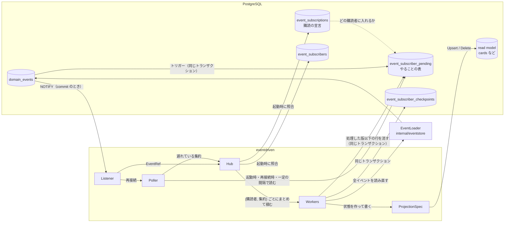
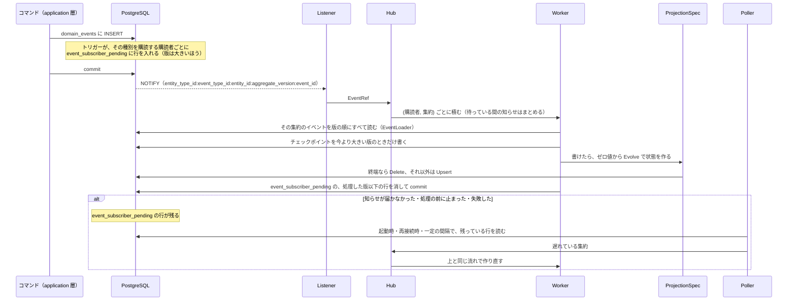
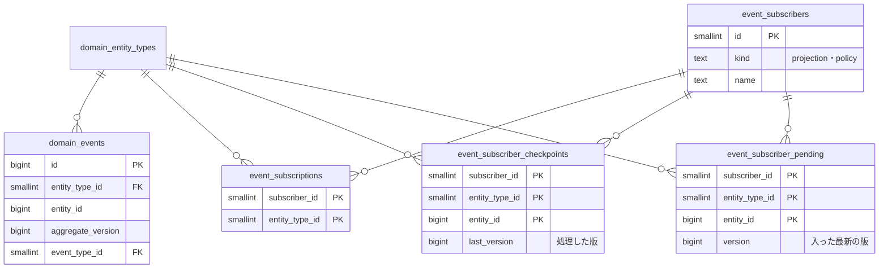

# internal/eventdriven

domain_events に保存されたイベントを受け取り、購読者（Projection）に渡して read model を作る仕組み。PostgreSQL の LISTEN/NOTIFY で知らせを受け、取りこぼしは Poller が拾う（参照の api の internal/eventdriven と同じ考え方）。

Policy（イベントを受けて別のコマンドを実行する購読者）は、まだ扱わない。

## 全体



## 1 つのイベントが read model に届くまで



- 処理中に同じ集約の知らせが来たら、終わった後にもう 1 回だけ作り直す
- 失敗（panic を含む）はログに出す。トランザクションは rollback され、やることの行が残るため、Poller が間隔ごとに作り直す
- Poller が読むのはやることの表だけなので、読む量は遅れている件数に比例する（イベントの総数によらない）

## 表



| 表 | 表すこと | 書く人 |
|---|---|---|
| event_subscribers | 購読者の id と名前 | マイグレーション |
| event_subscriptions | 購読者が購読する集約の種別（トリガーが購読者を引く） | マイグレーション |
| event_subscriber_checkpoints | 購読者 × 集約ごとの、処理した版。一度処理した集約の行はずっと残る | ワーカー |
| event_subscriber_pending | 購読者 × 集約ごとの、まだ作り直していない最新の版。遅れている間だけ行がある | トリガーが入れ、ワーカーが消す |

- `domain_events` への INSERT で、トリガー `notify_domain_event` が `domain_events_channel` に知らせ（migrations/0009）、トリガー `enqueue_event_subscriber_pending` がやることの表に行を入れる（migrations/0011）
- read model の表（`cards` など）は、ほかの表と外部キーでつながない。集約の削除は、削除のイベントを受けた投影が行を消す

## 部品

| 部品 | ファイル | 責務 |
|---|---|---|
| EventRef | event_ref.go | 知らせの中身（どの集約のどの版か）。DB を引かずに振り分けに使う |
| Listener | listener.go | LISTEN で知らせを受け、Hub に渡す。再接続は pq.Listener に任せ、つながり直したことを Hub に知らせる |
| Subscribers | subscriber.go | event_subscribers の (kind, name) と id の対応と、event_subscriptions。起動時に読み込み、コードの宣言と照合する |
| ProjectionSpec | projection.go | 投影の宣言（名前、購読する集約、Upsert・Delete）。全イベントを当てて状態を作り、書くまでを型を消さずに行う |
| Hub | hub.go | 投影の登録と照合（購読者・購読・集約の種別・イベントの読み方）。知らせを (購読者, 集約) ごとに振り分け、決まった本数のワーカーで処理する。起動・停止 |
| scheduler | scheduler.go | 作り直しを待つ (購読者, 集約) の列。同じキーの知らせをまとめ、同じキーを 2 本のワーカーが同時に処理しないようにする |
| チェックポイント・やることの表 | checkpoint.go | 処理した版を今より大きい版のときだけ書く（複数台で古い作り直しが新しいものを上書きしないため）。処理した版以下のやることの行を消す |
| Poller | poller.go | 起動時・再接続時・一定の間隔で、やることの表を読んで Hub に渡す（知らせの取りこぼしと失敗の安全網） |
| EventLoader | internal/eventstore/loader.go | 集約の型を知らずに、集約のイベントを版の順にすべて読む。集約ごとに internal/wiring で作って Hub に渡す |

## 投影を足す手順

1. read model の表を作るマイグレーションを足す（表の作りだけ。購読者・購読の行は入れない）
2. 購読者の一覧（internal/wiring/subscribers.go）に、id・名前・どのサービスのものかを足す（`eventdriven.ProjectionSubscriber`。id は 1000 から順に、自動で振らない）
3. read model の状態の型を作り、`Evolve(event any) S` と `IsTerminal() bool` を書く（ゼロ値が初期状態）
4. 状態を書く `Upsert` と、終端の状態の行を消す `Delete` を作る
5. internal/wiring（studio の投影なら internal/service/studio の `RegisterProjections`）で `eventdriven.RegisterProjection` に `ProjectionSpec` を渡す。購読する集約の `EventLoader` を Hub に渡しておく（internal/wiring/event_driven.go）

起動時に `Hub.Sync` が、Hub に渡した購読者と登録した投影を正として DB を合わせる（core#33）。

- `event_subscribers` に無い購読者は足す。同じ id で名前が違う・一覧に無い購読者の行がある・一覧にあるのに投影を登録していない、はエラーにして起動を止める（行は消さない）
- `event_subscriptions` は `ProjectionSpec.Subscriptions` に合わせて足し・消す。足した組には、すでにある集約の分の `event_subscriber_pending` の行を入れ（入れないと、次にイベントが来るまで作られない）、消した組のやること・チェックポイントも消す
- Hub には、そのサービスの購読者だけを渡す（studio 用・game 用の DB それぞれに、そのサービスの購読者だけができる）

購読する種別を後から足す・やめるときも、`ProjectionSpec.Subscriptions` を変えるだけでよい。読み方の無い集約は、起動時にエラーになる。

## 作り直す手順

read model をすべて作り直すときは、その購読者のチェックポイントを消し、やることの行を入れる（チェックポイントが残っていると、版が進んでいないため作り直さずに行を消す）。

```sql
BEGIN;
DELETE FROM event_subscriber_checkpoints WHERE subscriber_id = $1;
INSERT INTO event_subscriber_pending (subscriber_id, entity_type_id, entity_id, version)
SELECT $1, e.entity_type_id, e.entity_id, max(e.aggregate_version)
FROM domain_events e
JOIN event_subscriptions s ON s.subscriber_id = $1 AND s.entity_type_id = e.entity_type_id
GROUP BY e.entity_type_id, e.entity_id
ON CONFLICT (subscriber_id, entity_type_id, entity_id) DO UPDATE
SET version = GREATEST(event_subscriber_pending.version, EXCLUDED.version);
COMMIT;
```

次に Poller が読んだとき（一定の間隔）に作り直される。
