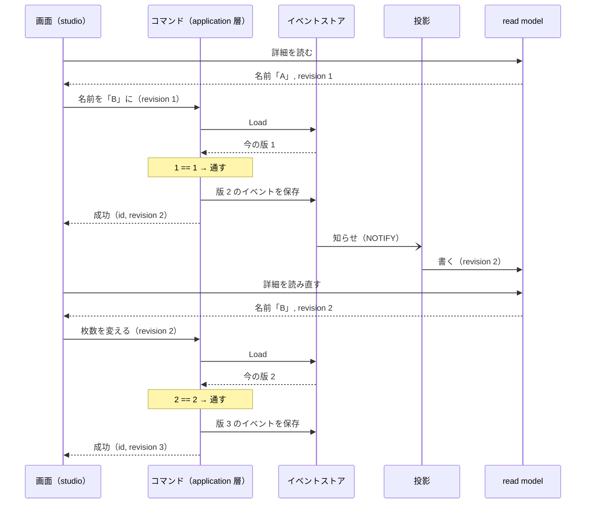
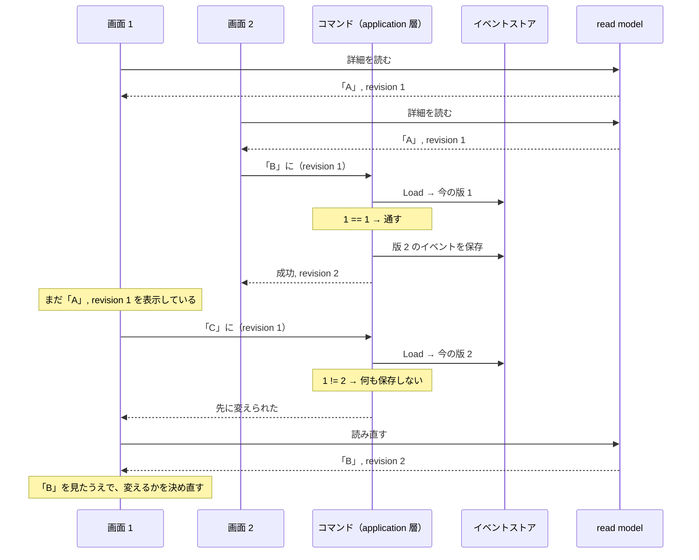
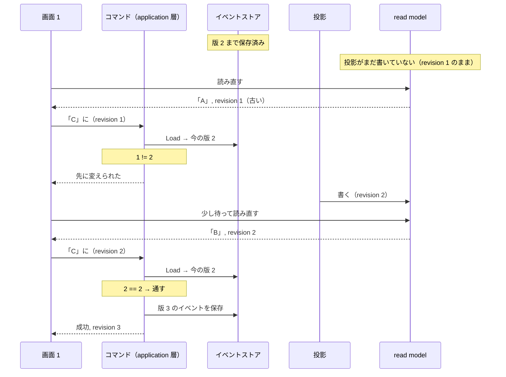

# internal/eventstore

集約のイベントを domain_events に保存し、版の順に読み直して状態を作る（`Save`・`Load`）。投影が読む `EventLoader` も置く。

## ログ

`Save` は、イベントごとに INFO のログ `eventstore: event saved`（`event_id`・`entity_type`・`entity_id`・`aggregate_version`・`event_type`・`occurred_at`）を出す。出すのは呼ぶ側の `rdb.Transact` が確定したあとで（`rdb.AfterCommit`）、取り消された保存は残さない。`eventdriven` の処理のログ（`eventdriven: event processed`）と項目の名前をそろえてあり、`event_id` で保存から処理までをたどれる（追い方は eventdriven の README）。

## トレース

`Save` は、ctx に有効なトレースがあれば、W3C の traceparent を `domain_events.traceparent` に書く（無ければ NULL）。payload（ドメインの事実）には入れない。`EventLoader` は読み出しで解釈し、`LoadedEvent.SpanContext` に持たせる（NULL・読めない文字列は無効な SpanContext）。`eventdriven` の hub が処理のログの ctx に載せ、保存したときの `trace_id` が付く。

## 版と revision

| 呼び方 | 何か | どこにあるか | 役割 |
|---|---|---|---|
| 版（aggregate_version） | 集約のイベントの通し番号。イベントを 1 つ保存するたびに 1 つ進む | domain_events | 保存のときの衝突の判定（同じ版のイベントは 1 つしか入らない） |
| revision | 画面が見ていた版。GraphQL では `revision` と呼ぶ（マスタの公開の版と取り違えないため） | 画面の中（read model の詳細から読む） | 「画面が何を見ていたか」を core に伝える |

`Save` は、版が続いていること（版 1 か、同じ集約の直前の版が既にある）も確かめ、版が飛んだイベントは保存せずに `domain.ErrVersionNotConsecutive` を返す。版を作るのは各集約の `Decide`（今の版 + 1）だが、どこから呼ばれても版が飛ばないことを保存する場所で保証するため。衝突（`domain.ErrVersionConflict`）は操作が重なっただけで起きうるのに対し、版の飛びはコードの誤りなので、エラーを分ける。

判定はいつも、コマンドの中でイベントストアから Load した今の版で行う。read model の版は表示用で、投影が遅れうるため判定には使わない。

衝突を見つける場所は 2 つある（core#24）。

| 確かめる場所 | 守る範囲 | 見つけること |
|---|---|---|
| application 層のコマンド（Load の直後に revision と今の版を比べる） | 画面を開いてから操作するまで（数分〜数時間） | 画面が古いまま操作した |
| イベントストアの `Save`（`ON CONFLICT DO NOTHING` で行が返らない → `domain.ErrVersionConflict`） | 1 回のリクエストの Load から保存まで | 比べた後に、ほかのリクエストに先を越された |

どちらも利用者から見れば「先に変えられた」なので、コマンドは同じエラー（`RevisionConflictError`）で返す。revision が要るのは、画面で見た内容をもとに既にあるものを変える・消す操作だけ（登録、画面を通らない操作には要らない）。

## ① ふだんの流れ（1 つの画面で続けて変える）

変える操作の結果は、公開 ID と新しい revision だけで、内容を返さない（core#24）。画面は詳細を読み直し、**詳細の revision** を持つ。表示している内容と revision が、いつも同じ時点（read model のその行）のものになる。結果の revision だけを持って古い詳細を表示すると、古い表示に基づく変更が通ってしまうため、結果の revision は持たない。

読み直しが投影より早いと、古い revision が返り、次の操作は「先に変えられた」になる（③と同じ）。ふだんの遅れは数ミリ秒なので、人が操作する速さではまず起きない。

## ② 画面が古い（2 つの画面から変える）

revision が無いと、画面 1 の「C」はそのまま版 3 として保存され、画面 1 の人が見ていない「B」を黙って上書きする。

## ③ read model の反映が遅れている

投影が追いつくまでは、読み直しても古い revision が返り、「先に変えられた」が続く。追いつけば通る。遅れの影響は「最新を見ているつもりなのに先に変えられたと言われる」側にだけ出て、古い画面からの変更を誤って通すことはない。投影が失敗し続けているあいだは編集もできないが、そのときは表示も古いので、古い表示のまま編集させないほうを選んだ（core#24）。

どのくらい遅れるか（2026-10-19 に結合テストと同じ組み立てで測った値。開発用のマシンで、DB が近く負荷が無い状態）: ふだん（NOTIFY が届いたとき）は、コマンドの結果が返ってから一覧に出るまで 2〜5 ミリ秒。人が画面を操作する速さでは、読み直したときにはふつう追いついている。知らせを取りこぼした・投影が失敗したときは、Poller が拾い直すまで待つ（間隔は cmd/app の `pollInterval`。今は 30 秒）。

